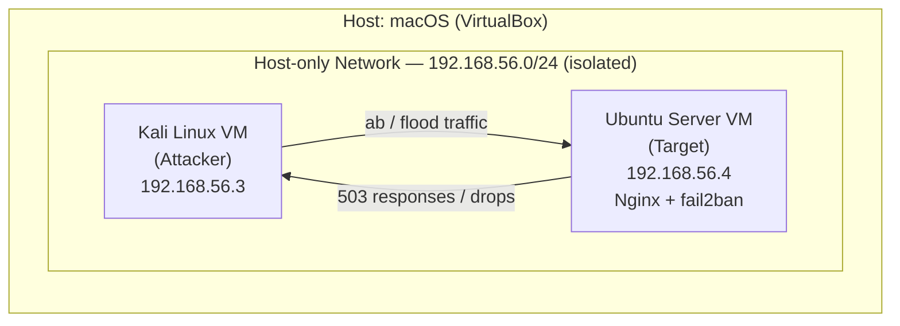
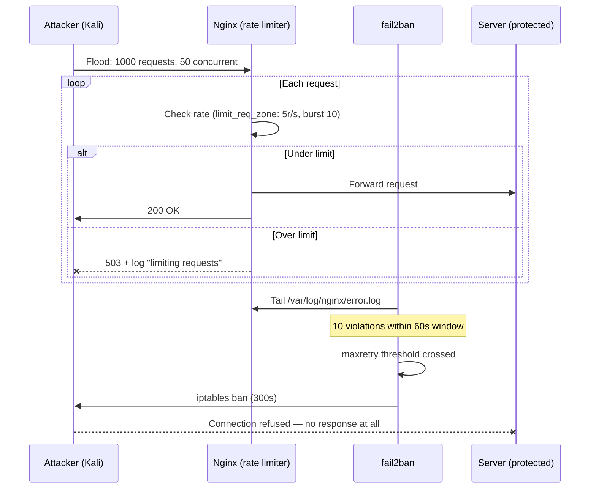
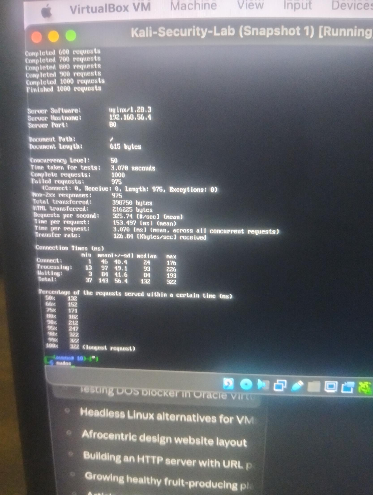
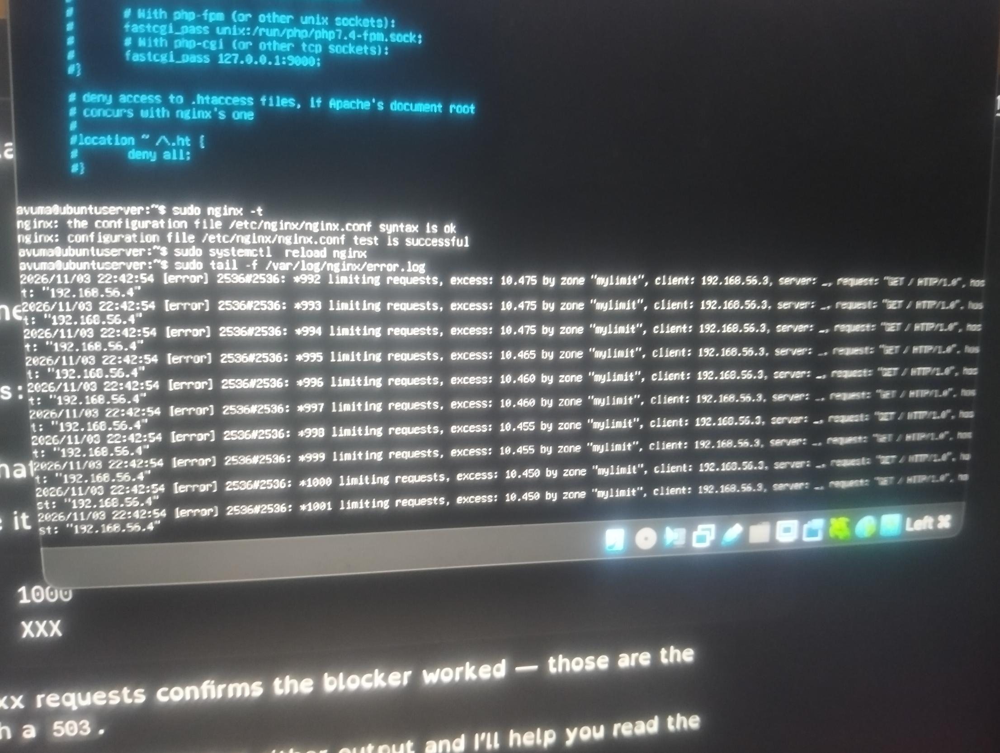
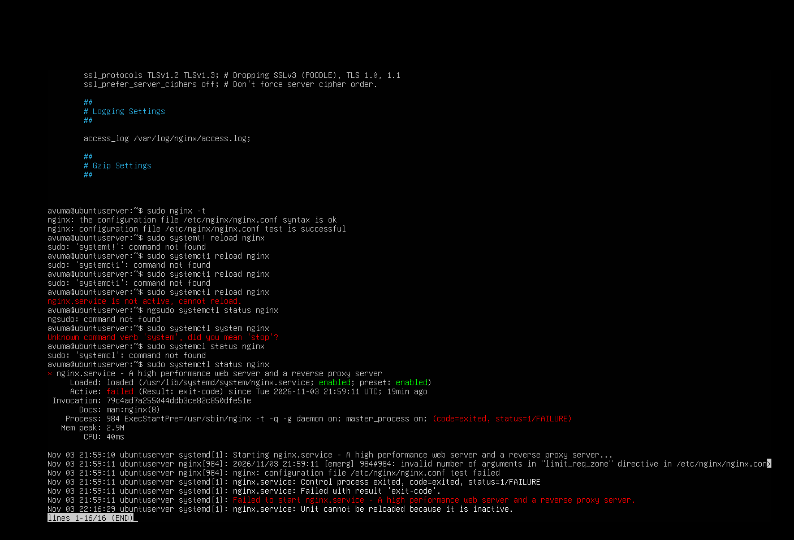
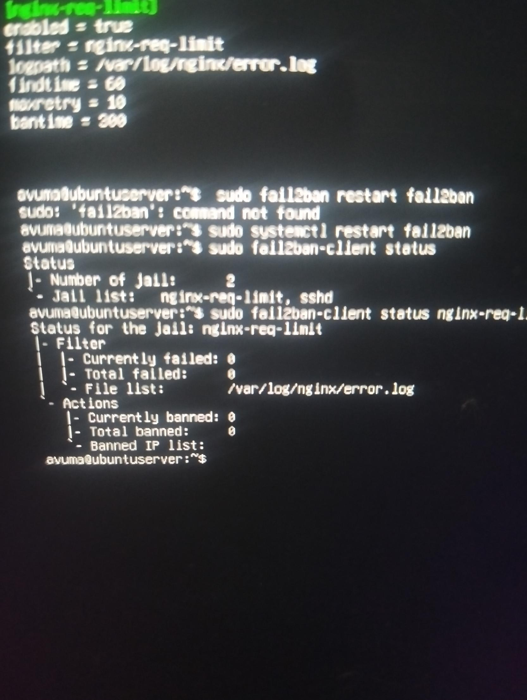
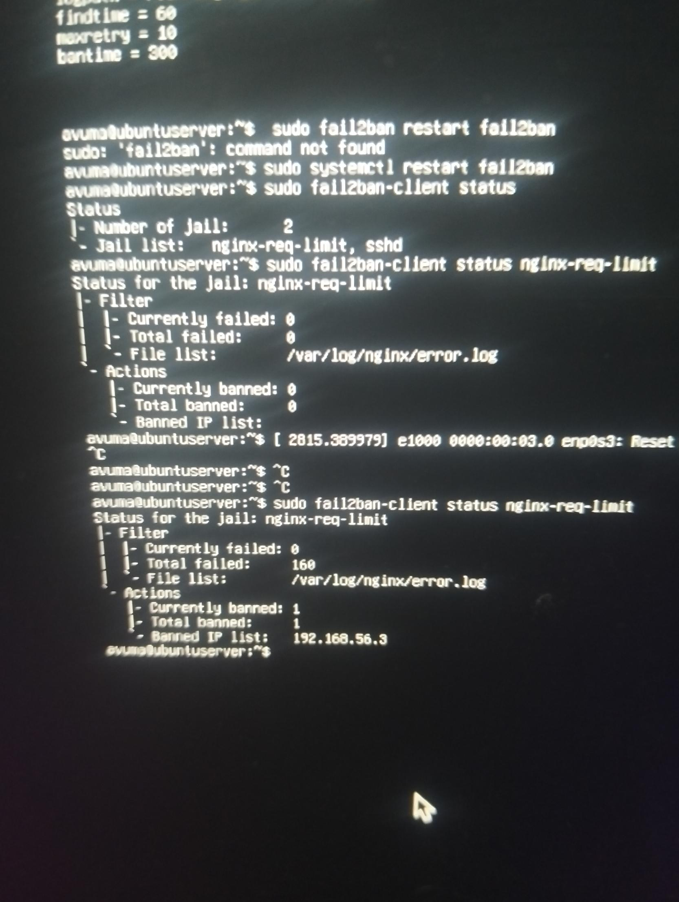

# DoS Mitigation Lab — Rate Limiting + Automated IP Banning

A self-contained, isolated VM lab built to test and verify two layers of denial-of-service
defense against a simulated flood attack: **Nginx request rate limiting** and
**fail2ban automated IP banning**. Everything below — the config, the attack, and the
results — was run and captured by me in my own VirtualBox environment.

> **AI disclosure:** I used Claude (Anthropic) as a guided assistant throughout this project —
> for explaining concepts, walking through command syntax, and helping debug errors as they
> came up (several are documented below, typos and all). The environment, the testing, the
> debugging, and the decisions were mine. I'm including that context because I think it's more
> useful to recruiters than pretending otherwise.

---

## Why I built this

I'm working toward a cybersecurity career and wanted hands-on, practical experience with a
real attack/defense cycle rather than just reading about rate limiting in the abstract. The
brief I set myself: **stand up a target web server, prove it's vulnerable to a basic flood,
then layer on defenses and prove they work — with evidence, not just claims.**

I was specifically advised not to run flood/load-testing tools against my own machine or
network, so the entire test was built inside an **isolated VirtualBox host-only network** —
no traffic ever touched my real LAN or the internet.

---

## Lab architecture



Both VMs ran on a **Host-only Adapter**, deliberately excluding Bridged/NAT on the attack
path — confirmed before testing by checking that the attacker VM had no route to the public
internet.

---

## Defense architecture — how a flood gets stopped



---

## Tools & skills demonstrated

| Area | What I used / did |
|---|---|
| **Virtualization** | Oracle VirtualBox — isolated host-only networking, snapshotting, VM lifecycle |
| **OS admin** | Ubuntu Server (headless, CLI-only) — package management, `systemctl`, log inspection |
| **Web server config** | Nginx — `limit_req_zone`, `limit_req`, config syntax validation (`nginx -t`), service reload |
| **Intrusion prevention** | fail2ban — custom filter regex, custom jail definition, `fail2ban-client` operations |
| **Offensive tooling (lab only)** | Kali Linux, Apache Bench (`ab`) for load generation |
| **Networking fundamentals** | Host-only vs. NAT vs. Bridged adapters, IP addressing, connectivity verification (`ping`, `curl`) |
| **Linux CLI** | `nano`, file permissions, `systemctl`, `journalctl`, log tailing, regex-based log filters |
| **Debugging under pressure** | Diagnosed and fixed a broken config directive, a service-not-running error, and multiple command typos using service logs (`journalctl -xeu`) rather than guesswork |

---

## What I actually learned

- **Rate limiting ≠ blocking.** Nginx's `limit_req` throttles traffic per-IP but still processes
  every request up to the burst limit — it reduces load, it doesn't eliminate the attacker's
  access. That's *why* I added fail2ban on top.
- **fail2ban doesn't watch traffic directly — it watches logs.** It needed a custom filter
  (regex) to recognize Nginx's `"limiting requests, excess: ... client: <HOST>"` log line as a
  "violation" before it could act on it. Understanding that log-driven detection model was the
  main conceptual takeaway of this project.
- **A `reload` only works on a running service.** I hit `nginx.service is not active, cannot
  reload` because I reloaded before the service had ever successfully *started* — a config
  error earlier had prevented that. `reload` ≠ `start`, and `journalctl -xeu` was what actually
  showed me why the start had failed.
- **Isolate before you attack, even in a lab.** Keeping the attacker VM off NAT/Bridged
  networking the whole time meant I could run real flood traffic without any risk to my own
  machine or network — a habit I'd carry into any future pentesting work.

---

## Results

### 1. Baseline flood — Nginx rate limiting alone
`ab -n 1000 -c 50 http://192.168.56.4/`

| Metric | Value |
|---|---|
| Requests sent | 1000 |
| Failed / non-2xx (rejected by rate limiter) | 975 |
| Requests per second | 325.74 |




### 2. Config validation before going live


### 3. fail2ban jail configured and active


### 4. Automated ban triggered by the second flood
After re-running the same flood with fail2ban active:

| Metric | Before | After |
|---|---|---|
| Total failed (rate-limit hits) | 0 | 160 |
| Currently banned | 0 | 1 |
| Banned IP | — | `192.168.56.3` (the attacker) |



Once banned, the attacker's `curl` requests stopped getting any response at all —
the difference between **throttled** (still gets a 503) and **blocked** (connection refused
at the firewall).

---

## Config excerpts

**`nginx.conf`** (inside the `http {}` block):
```nginx
limit_req_zone $binary_remote_addr zone=mylimit:10m rate=5r/s;
```

**`sites-available/default`** (inside `location / {}`):
```nginx
limit_req zone=mylimit burst=10 nodelay;
```

**`/etc/fail2ban/filter.d/nginx-req-limit.conf`**:
```ini
[Definition]
failregex = limiting requests, excess:.* by zone.*client: <HOST>
ignoreregex =
```

**`/etc/fail2ban/jail.local`** (appended):
```ini
[nginx-req-limit]
enabled = true
filter = nginx-req-limit
logpath = /var/log/nginx/error.log
findtime = 60
maxretry = 10
bantime = 300
```

---

## Next steps I'm considering

- Simulating a lower-level SYN flood with `hping3 --flood` to test whether rate limiting +
  fail2ban is sufficient against transport-layer attacks, or whether firewall-level (`iptables`)
  rules are also needed
- Tightening `burst` and re-testing to map the threshold more precisely
- Comparing this against a cloud WAF (AWS WAF / Cloudflare) rate-limiting setup as part of my
  broader cloud security learning path

---

## Repo structure
```
dos-blocker-lab/
├── README.md
├── LICENSE
├── .gitignore
└── assets/
    ├── 01-ab-flood-results.jpg
    ├── 02-nginx-rate-limit-log.jpg
    ├── 03-nginx-config-test-success.png
    ├── 04-fail2ban-jail-status.jpg
    └── 05-fail2ban-ip-banned.jpg
```
